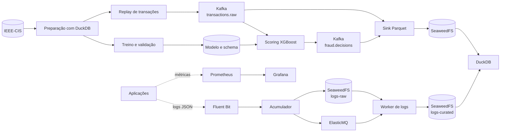

# FraudShield


## Sobre o projeto

O **FraudShield** reúne engenharia de dados e machine learning para simular um
sistema de detecção de fraudes em streaming. O projeto também se inspira no
**Alexandria**, plataforma de logs desenvolvida pelo time de engenharia do
Nubank, especialmente nos conceitos de auditoria, observabilidade e integridade
dos logs.

## Objetivo

Construir uma solução reproduzível que seja capaz de:

- preparar e validar dados da competição **IEEE-CIS Fraud Detection**;
- treinar e comparar um baseline com um modelo XGBoost;
- avaliar o modelo em períodos temporais separados, evitando vazamento de dados;
- publicar transações no Kafka e processá-las com um serviço de scoring;
- classificar cada transação como `APPROVE`, `REVIEW` ou `BLOCK`;
- persistir transações e decisões em arquivos Parquet de forma idempotente;
- coletar e processar logs estruturados em um fluxo inspirado no padrão Alexandria;
- acompanhar latência, throughput, filas e erros por meio de dashboards;
- testar reentrega, recuperação de falhas, DLQ e ausência de duplicatas lógicas.

## Arquitetura proposta

O diagrama apresenta a arquitetura-alvo ao final dos marcos. No primeiro fluxo
de streaming, o sink gravará Parquet localmente; a integração com o SeaweedFS
será acrescentada junto ao pipeline de armazenamento de objetos.



O fluxo adota processamento com reentrega e efeitos idempotentes. Os offsets ou
mensagens só deverão ser confirmados depois da persistência correspondente. No
pipeline de logs, uma rotina de reconciliação recuperará objetos gravados que
eventualmente não tenham sido publicados na fila após uma interrupção.

## Tecnologias

| Área | Tecnologias | Responsabilidade |
| --- | --- | --- |
| Linguagem | Python 3.12 | Preparação, treinamento e serviços da aplicação |
| Machine learning | scikit-learn e XGBoost | Pré-processamento, baseline, treino e inferência |
| Dados analíticos | DuckDB e Apache Parquet | Recortes, consultas e persistência colunar |
| Streaming | Apache Kafka em modo KRaft | Transporte de transações e decisões |
| Armazenamento | SeaweedFS com API compatível com S3 | Objetos de transações, decisões e logs |
| Filas | ElasticMQ com API compatível com SQS | Notificações, retentativas e DLQ de logs |
| Coleta de logs | Fluent Bit | Encaminhamento de logs JSON dos serviços |
| Observabilidade | Prometheus e Grafana | Métricas, alertas e dashboards |
| Infraestrutura | Docker Desktop, Docker Compose e WSL2 | Execução local e isolamento dos componentes |
| Testes | pytest | Testes unitários, de integração e de aceite |

As versões exatas das imagens e bibliotecas serão fixadas conforme cada
componente for implementado e validado.

## Estado atual

A primeira base executável do M1 está disponível. Ela valida contratos de
eventos e executa, com dados sintéticos, o fluxo de preparação temporal:

```text
CSV de transações + CSV de identidade
→ validação de qualidade
→ LEFT JOIN por TransactionID
→ ordenação por TransactionDT e TransactionID
→ treino, validação e teste em Parquet
→ replay sem isFraud
→ relatório de qualidade e manifesto com hashes
```

O fluxo sintético está coberto por testes automatizados. A execução com o
dataset completo do IEEE-CIS permanece pendente.

## Executando o primeiro marco

### 1. Preparar o ambiente no Windows

O projeto usa CPython 3.12. No PowerShell, a partir da raiz do repositório:

```powershell
winget install --id Python.Python.3.12 --exact --source winget `
  --architecture x64 --scope user `
  --accept-source-agreements --accept-package-agreements

$python312 = "$env:LOCALAPPDATA\Programs\Python\Python312\python.exe"
if (-not (Test-Path -LiteralPath $python312)) {
  throw "Ajuste `$python312 para o local em que o Python 3.12 foi instalado."
}

& $python312 -m venv .venv
.\.venv\Scripts\python.exe -m pip install --upgrade pip
.\.venv\Scripts\python.exe -m pip install -e ".[dev]"
```

Não é necessário ativar o ambiente virtual; os comandos usam seu executável
diretamente.

### 2. Validar a instalação

```powershell
.\.venv\Scripts\python.exe -m pip check
.\.venv\Scripts\python.exe -m ruff check .
.\.venv\Scripts\python.exe -m pytest
```

### 3. Executar a demonstração sintética

```powershell
.\.venv\Scripts\python.exe -m fraudshield_prepare `
  --transactions tests/fixtures/transactions.csv `
  --identity tests/fixtures/identity.csv `
  --output data/prepared/demo `
  --train-rows 6 `
  --validation-rows 3 `
  --test-rows 3 `
  --threads 1 `
  --memory-limit 512MB
```

A execução produz:

- `train.parquet`, `validation.parquet` e `test.parquet`;
- `replay.parquet`, sem o rótulo `isFraud`;
- `test_labels.parquet`, separado do replay;
- `quality_report.json`, com contagens, nulos, duplicatas e cobertura do join;
- `manifest.json`, com configuração, schema e hashes dos artefatos.

Se a validação falhar, o pipeline não publica uma saída parcial. As mesmas
entradas e recortes geram o mesmo `run_id`; o manifesto também permanece igual
quando toda a configuração de execução é mantida.

## Dados e avaliação

O modelo utilizará os arquivos `train_transaction.csv` e
`train_identity.csv` da competição
[IEEE-CIS Fraud Detection](https://www.kaggle.com/competitions/ieee-fraud-detection/data).

Os registros serão associados por `TransactionID`, ordenados por
`TransactionDT` e divididos inicialmente da seguinte forma:

| Período | Quantidade inicial | Uso |
| --- | ---: | --- |
| Primeiro recorte | 120.000 | Treinamento |
| Segundo recorte | 30.000 | Validação e escolha dos limiares |
| Terceiro recorte | 50.000 | Teste final e replay no Kafka |

A coluna `isFraud` será mantida fora das features e dos eventos de inferência.
As métricas previstas incluem PR-AUC, precision, recall, matriz de confusão e
desempenho por janela temporal.

## Contratos principais

| Tópico Kafka | Chave | Conteúdo |
| --- | --- | --- |
| `transactions.raw` | `transaction_id` | Transação sem o rótulo `isFraud` |
| `fraud.decisions` | `transaction_id` | Score, decisão, modelo e correlação |
| `transactions.dlq` | `transaction_id` | Evento inválido ou falha irrecuperável |

Cada decisão será vinculada a um `schema_version`, `model_version`,
`correlation_id` e `run_id`. O mesmo pipeline de pré-processamento deverá ser
usado no treinamento e na inferência em streaming.

## Roadmap

- [ ] **M1 — Ambiente e dados:** a base sintética e os contratos estão prontos;
  falta executar o dataset IEEE-CIS e registrar o relatório real de qualidade.
- [ ] **M2 — Modelo:** treinar baseline e XGBoost, selecionar limiares e
  versionar o pipeline e suas métricas.
- [ ] **M3 — Streaming:** executar Kafka, replay, scoring e sink Parquet
  local com 1.000 eventos, incluindo testes de repetição e reinício.
- [ ] **M4 — Objetos e pipeline de logs:** integrar SeaweedFS e implementar
  Fluent Bit, ElasticMQ, worker, retentativas, DLQ e reconciliação.
- [ ] **M5 — Observabilidade e carga:** consolidar dashboards, consultas e o
  teste de 50 mil eventos.
- [ ] **M6 — Entrega reproduzível:** finalizar documentação, evidências,
  runbook e rotinas seguras de limpeza.

---

