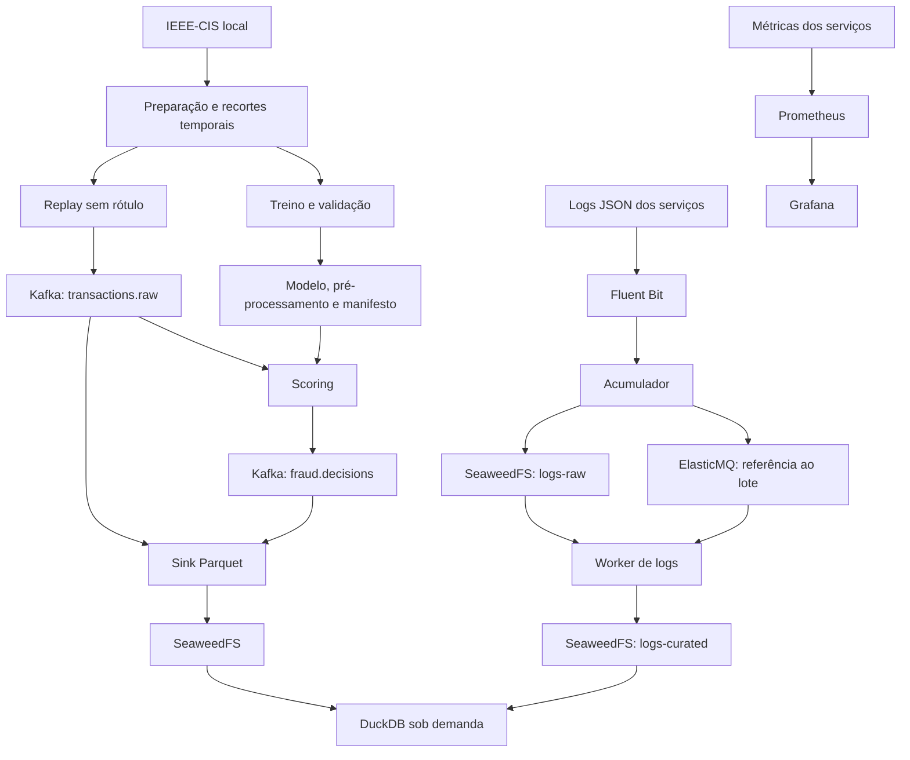

# Planejamento inicial do FraudShield

## Escopo descrito no guia

- Dados IEEE-CIS associados por `TransactionID` com `LEFT JOIN` e ordenados por
  `TransactionDT`.
- Recorte inicial de 120 mil transações para treino, 30 mil para validação e
  50 mil para teste final e replay. Documentar distribuição e fronteiras.
- Baseline e XGBoost com pré-processamento persistido, schema explícito,
  avaliação temporal e manifesto de artefatos com versão e hash.
- Kafka com os tópicos `transactions.raw`, `fraud.decisions` e
  `transactions.dlq`, inicialmente com uma partição por tópico.
- Persistência de transações e decisões em Parquet; tabelas curadas sem
  duplicação lógica após reentregas.
- Logs JSON correlacionáveis, Fluent Bit, acumulador, SeaweedFS compatível com
  S3, ElasticMQ compatível com SQS, worker, retentativas e DLQ.
- Prometheus, Grafana, consultas DuckDB e evidências de qualidade, desempenho,
  integridade e recuperação de falhas.

## Fluxos previstos

## Invariantes para a implementação

1. **Evitar vazamento de rótulos:** `isFraud` permanece fora das features,
   eventos de entrada e logs. Rótulos do replay ficam em tabela de avaliação
   separada. Ajustar transformações somente no treino, escolher limiares na
   validação e preservar o teste final para avaliação após congelamento.
2. **Paridade offline e streaming:** usar o mesmo pré-processamento e schema.
   Testar que uma transação produz o mesmo score nos dois caminhos.
3. **Entrega e persistência:** assumir reentregas. Confirmar offsets ou
   mensagens somente após o efeito durável correspondente; definir o
   protocolo de commit e a deduplicação da visão curada antes do sink.
4. **Recuperação dos logs:** salvar o objeto antes de publicar sua referência.
   Acrescentar registro durável de publicação pendente ou reconciliação para
   recuperar uma queda entre essas duas operações. O worker será idempotente.
5. **Medição real:** registrar RAM, CPU, disco, throughput e p50/p95 no
   primeiro replay; definir metas de desempenho a partir dessa evidência.
6. **Dados e acesso:** preservar dados originais em qualquer limpeza;
   manter credenciais e datasets fora do Git e dados sensíveis fora dos logs;
   limitar a exposição dos serviços ao ambiente local.

## Pontos a detalhar antes dos respectivos marcos

| Ponto | Encaminhamento proposto | Marco |
| --- | --- | --- |
| Recursos e ferramentas | Verificar a máquina; definir orçamento de RAM/CPU/disco e versões compatíveis, fixadas | M1 |
| Dados disponíveis | Confirmar acesso ao Kaggle e presença dos dois CSVs; usar dados sintéticos apenas para testes de integração | M1 |
| Recortes | Ordenação determinística por `TransactionDT` e `TransactionID`, duplicatas, ausentes e fronteiras documentadas | M1 |
| Métricas de modelo | Definir o cálculo chamado PR-AUC, além de precision, recall, matriz de confusão e análise por janela | M2 |
| Contrato completo | Features, tipos, ausentes, categorias desconhecidas, schema, modelo e dois limiares para as três decisões | M2 |
| Tempo dos eventos | Distinguir tempo histórico, envio do replay e processamento; documentar eventual origem sintética para UTC | M3 |
| Identidade e commits | Formalizar `transaction_id + model_version`, identificação dos lotes e recuperação de gravação interrompida | M3 |
| Múltiplas execuções | Usar `run_id` em evidências e relatórios; documentar como ele interage com a deduplicação | M3 |
| Coleta no Windows | Validar um mecanismo de coleta de stdout compatível com Docker Desktop | M4 |
| Objeto sem notificação | Testar queda após upload e antes do envio à fila; reconciliar a publicação | M4 |
| Observabilidade | Instrumentar serviços desde sua criação e consolidar dashboards em M5 | M3-M5 |

## Marcos e evidências de conclusão

Todos os marcos de implementação estão **pendentes**. A análise do guia e o
registro deste planejamento não comprovam execução de nenhum componente.

| Marco | Entrega | Evidência mínima |
| --- | --- | --- |
| M1 | Ambiente verificado e dataset preparado | Versões e recursos registrados; contagens, distribuição de fraude, qualidade e períodos dos recortes (T01) |
| M2 | Baseline, XGBoost e pipeline congelado | Métricas, schemas, hashes e predição reproduzível (T02) |
| M3 | Kafka, replay, scoring e sink | 1.000 IDs distintos, repetição sem duplicatas na tabela curada e reinício sem perda; paridade de score; métricas básicas (T03-T05) |
| M4 | Pipeline de logs | Acúmulo com worker parado, retomada, tratamento de inválidos/DLQ e recuperação da janela upload/fila (T06-T07 e cenário adicional) |
| M5 | Análise, dashboards e carga | Contagens reconciliadas, métricas visíveis e relatório de 50 mil eventos com recursos e integridade (T08-T10) |
| M6 | Execução reproduzível | README, runbook, evidências e limpeza/reset que preservam os dados originais |

T01-T10 referem-se aos critérios do guia, página 6. Cada etapa deverá incluir
suas verificações; o dashboard completo poderá ser consolidado posteriormente.

## Sugestões de inovação

Estas propostas são recomendações iniciais, ainda não incorporadas ao escopo
de entrega do MVP. Priorizar o simulador depois de estabelecer a avaliação
confiável do modelo; medir o custo das demais antes de ativá-las no streaming.

### 1. Simulador de políticas de decisão

Variar os dois limiares que definem `APPROVE`, `REVIEW` e `BLOCK` e apresentar
fraudes detectadas, falsos positivos, revisões por mil transações e impacto
estimado sob premissas configuráveis de custo e capacidade de revisão.

Executar comparações na validação temporal e congelar a política escolhida
antes do teste final. Identificar as premissas do simulador e a origem/unidade
dos valores do dataset. O custo de revisão e seu resultado precisam ser
modelados explicitamente, sem assumir que toda revisão identifica uma fraude.

**Valor esperado:** demonstrar o equilíbrio entre detecção, atrito para o
cliente e trabalho de análise. É a recomendação de maior prioridade.

Base técnica: o [exemplo oficial de decisão sensível a custo do scikit-learn](https://scikit-learn.org/stable/auto_examples/model_selection/plot_cost_sensitive_learning.html)
mostra ajuste de limiares por métricas de negócio, incluindo valores por
transação. A adaptação proposta aqui preserva os recortes temporais do guia.

### 2. Explicações por transação

Mostrar as principais contribuições das features para o score de uma
transação, com referência ao modelo e ao schema usados. Começar sob demanda
ou em amostra para medir latência e memória antes de ampliar o uso.

**Valor esperado:** facilitar investigação e demonstração. As contribuições
explicam o comportamento do modelo; não demonstram a causa real de fraude.
Features anonimizadas devem manter descrições honestas, sem inventar seu
significado de negócio.

Base técnica: o [XGBoost oferece contribuições de features com `pred_contribs`](https://xgboost.readthedocs.io/en/stable/prediction.html).
O alinhamento com as features transformadas deverá fazer parte da integração.

### 3. Monitoramento de mudança nos dados

Comparar janelas de replay com uma referência congelada: distribuição de
valores e scores, categorias desconhecidas e proporção de ausentes. Introduzir
cenários sintéticos identificados para demonstrar alertas de mudança.

**Valor esperado:** mostrar quando investigar a adequação do modelo. Mudança
de distribuição não comprova queda de precision/recall; essas métricas exigem
rótulos observados. O primeiro desenho prevê alerta e investigação, com
retreinamento avaliado em uma etapa posterior.

Base técnica: o [material de monitoramento da Evidently](https://learn.evidentlyai.com/ml-observability-course/module-2-ml-monitoring-metrics/data-prediction-drift-in-ml)
descreve mudanças nas distribuições de entradas e predições como sinais para
investigação, inclusive quando os rótulos ainda não estão disponíveis.

## Fontes técnicas consultadas

Além do PDF de requisitos, foram consultadas em 22/10/2026 as documentações
oficiais de [perfis do Docker Compose](https://docs.docker.com/compose/how-tos/profiles/),
[predição no XGBoost](https://xgboost.readthedocs.io/en/stable/prediction.html) e
[decisão sensível a custo no scikit-learn](https://scikit-learn.org/stable/auto_examples/model_selection/plot_cost_sensitive_learning.html),
além do [material de monitoramento da Evidently](https://learn.evidentlyai.com/ml-observability-course/module-2-ml-monitoring-metrics/data-prediction-drift-in-ml).
As versões concretas das dependências serão verificadas e fixadas na implementação.
